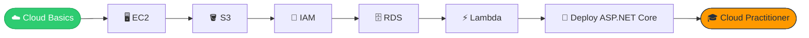

<!-- ============== HERO ============== -->
<div align="center">


<a href="https://github.com/habibkhalqi">
  
</a>

<br/>


<br/><br/>

<a href="https://www.linkedin.com/in/habib-khalqi-7b88982a4/"></a>
<a href="https://twitter.com/habib_khalqi"></a>
<a href="https://instagram.com/habib_khalqi"></a>
<a href="mailto:hkbalti44@gmail.com"></a>

</div>


<!-- ============== ABOUT ============== -->
<div align="center">
  
</div>


```yaml
Name     : Habibullah
Location : Pakistan 🇵🇰
Focus    : .NET Development • Data Analysis • Cloud
Learning : ASP.NET Core, EF Core, REST APIs, AWS ☁️
Passion  : Clean Code & Problem Solving
Email    : hkbalti44@gmail.com
```

> 🔭 Building projects with **.NET & C#**
> ☁️ Exploring **Amazon Web Services (AWS)** — hosting, storage & deployment
> 🌱 Deepening **ASP.NET Core** & **Data Analysis**
> 💡 Into **Software Architecture** & **Clean Code**
> 📊 Love turning raw data into **meaningful insights**
> ⚡ Fun fact: *I write bugs just to have the joy of fixing them* 😄

<br clear="right"/>

<!-- ============== TECH STACK ============== -->
<div align="center">
  

  <h4>Languages & Frameworks</h4>
  

  <h4>Tools & Databases</h4>
  
  

  <h4>☁️ Cloud <sub>(currently learning)</sub></h4>
  
  
  
  
  
</div>

<!-- ============== LEARNING ============== -->
<div align="center">
  

| 🚀 Topic | 📈 Progress |
|:--|:--|
| **ASP.NET Core & EF Core** |  |
| **REST APIs** |  |
| **Data Analysis (Pandas / NumPy)** |  |
| **☁️ Amazon Web Services (AWS)** |  |

</div>

### 🗺️ My AWS Roadmap



<!-- ============== STATS ============== -->
<div align="center">
  

  
  

  <br/>

  

  <h4>🏆 Trophies</h4>
  

  <h4>📈 Contribution Graph</h4>
  

  <h4>🐍 Contribution Snake</h4>
  
</div>

<!-- ============== CODE ============== -->
<div align="center">
  
</div>

```csharp
public class Habibullah : IDeveloper
{
    public string[] Skills => new[] { "C#", ".NET", "ASP.NET Core", "Python", "SQL" };
    public string   Cloud  => "AWS ☁️ (learning)";
    public string   Motto  => "Keep Learning, Keep Building, Keep Growing";

    public void Today()
    {
        while (alive)
        {
            Learn();
            Build();
            FixBugs();   // the fun part 😄
        }
    }
}
```

<!-- ============== COLLAB ============== -->
<div align="center">
  

  <p>Open to <b>.NET projects</b> • <b>data analysis work</b> • <b>cloud learning buddies</b></p>

  <a href="mailto:hkbalti44@gmail.com"></a>

  <br/><br/>

  <i>"Keep Learning, Keep Building, Keep Growing"</i> 🚀

  
</div>
